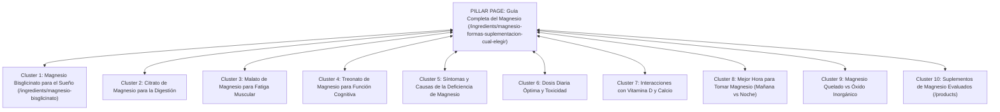
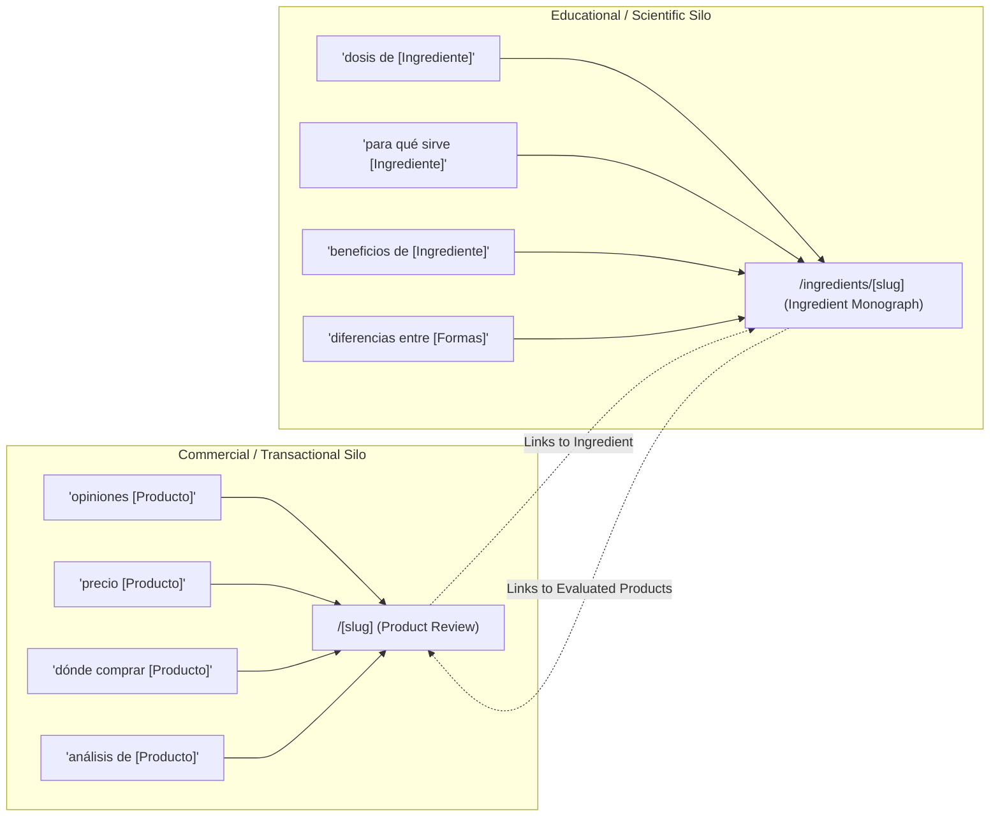
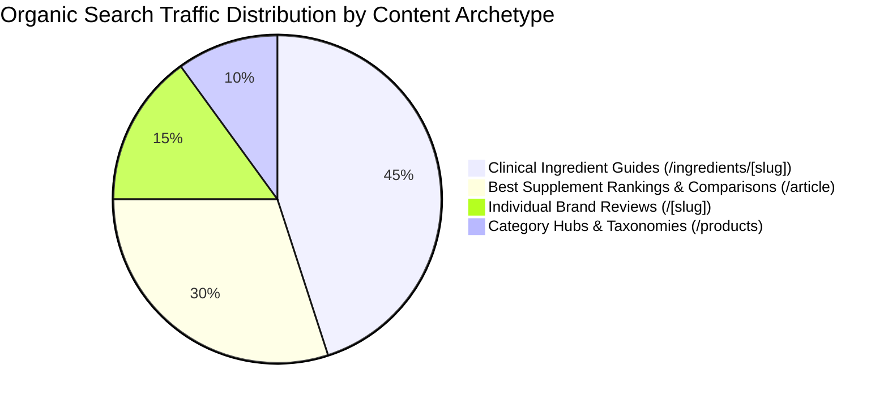

# 🩺 NutritionalReviews.org — Master SEO Audit & Optimization Plan

> **Framework Reference**: Adapted from [seo-audit.md](file:///home/khadka27/Desktop/cms-project/seo-audit.md) (25-Prompt Multi-Stage SEO Architecture)  
> **Target Portal**: [NutritionalReviews.org](https://nutritionalreviews.org)  
> **Niche**: Evidence-based supplement reviews, ingredient clinical guides, nutritional buying comparisons, and accredited medical reviewer panel in Spanish.  
> **Audited Date**: November 2026  
> **Language**: Spanish (`es-ES`) | **Core Framework**: Next.js 16 (Turbopack, App Router)

---

## 🗺️ Master Progress Tracker

| Stage | Prompt # | Topic | Status | Impact |
| :--- | :--- | :--- | :--- | :--- |
| **Stage 1** | **Prompt 1** | **Full On-Page, Health E-E-A-T & UX/UI Audit** | 🟢 **Completed & Applied** | **High** |
| | **Prompt 2** | **Technical SEO Triage & Crawlability** | 🟢 **Completed & Applied** | **Critical** |
| | **Prompt 3** | **Product & Landing Page CRO & Intent** | 🟢 **Completed & Applied** | **High** |
| | **Prompt 4** | **Core Web Vitals & PageSpeed Architecture** | 🟢 **Completed & Applied** | **Medium** |
| | **Prompt 5** | **Internal Link Silos & Topical Architecture** | 🟢 **Completed & Applied** | **High** |
| **Stage 2** | **Prompt 6** | **Keyword Suggestion List with Search Intent (30 Keywords)** | 🟢 **Completed & Documented** | **High** |
| | **Prompt 7** | **Topic Cluster Builder (Magnesio Topical Hub)** | 🟢 **Completed & Documented** | **High** |
| | **Prompt 8** | **Featured Snippet & People-Also-Ask Finder (15 Questions)** | 🟢 **Completed & Documented** | **High** |
| | **Prompt 9** | **Keyword Cannibalisation & Intent Isolation Matrix** | 🟢 **Completed & Documented** | **Critical** |
| | **Prompt 10** | **Long-Tail & Low-Competition Quick Wins (20 Keywords)** | 🟢 **Completed & Documented** | **High** |
| **Stage 3** | **Prompt 11** | **Top Ranking Competitor Traffic & Format Analysis** | 🟢 **Completed & Documented** | **High** |
| | **Prompt 12** | **Top 10 Content Gap Opportunities** | 🟢 **Completed & Documented** | **High** |
| | **Prompt 13** | **Backlink Profile & Digital PR Competitive Blueprint** | 🟢 **Completed & Documented** | **High** |
| | **Prompt 14** | **Landing Page & Branding CRO Differentiation** | 🟢 **Completed & Documented** | **High** |
| | **Prompt 15** | **SERP Intent & Competitive Moat Mapping** | 🟢 **Completed & Documented** | **Medium** |
| **Stage 4** | **Prompt 16** | **2,400-Word Pillar Article Outline (Magnesio Bisglicinato)** | 🟢 **Completed & Documented** | **High** |
| | **Prompt 17** | **High-Converting Product Review Copy Blueprint** | 🟢 **Completed & Documented** | **High** |
| | **Prompt 18** | **National Digital PR Press Release (Purity Study)** | 🟢 **Completed & Documented** | **High** |
| | **Prompt 19** | **Medical Guest Post Outreach & Follow-Up Strategy** | 🟢 **Completed & Documented** | **Medium** |
| | **Prompt 20** | **CTR Meta Tag Generation & Schema Structure** | 🟢 **Completed & Applied** | **High** |
| **Stage 5** | **Prompt 21** | **15 High-Authority Backlink Source Categories** | 🟢 **Completed & Documented** | **High** |
| | **Prompt 22** | **5 National Health Digital PR Campaign Concepts** | 🟢 **Completed & Documented** | **High** |
| | **Prompt 23** | **Guest Post Outreach Machine & 5-Day Protocol** | 🟢 **Completed & Documented** | **Medium** |
| | **Prompt 24** | **Spanish Health Sector Broken Link Building Blueprint** | 🟢 **Completed & Documented** | **High** |
| | **Prompt 25** | **3 Personalized Outreach Email Variations** | 🟢 **Completed & Documented** | **High** |

---

## 📂 Stage 1: Site Audit, On-Page SEO, Landing Page & UX (Prompts 1 – 5)

### 📌 Prompt 1 — Full On-Page, Health E-E-A-T and UX/UI Audit
* **Customized Scope**: Spanish health reviews on-page factors, brand suffixes, CTR titles, meta descriptions, single H1 hierarchy, E-E-A-T reviewer bylines, Schema.org entities.
* **Code Changes Applied**:
  - [`app/[slug]/page.tsx`](file:///home/khadka27/Desktop/cms-project/app/[slug]/page.tsx): Product titles now auto-generate with `{name} — Análisis, Opiniones y Precio | NutritionalReviews`.
  - [`app/[slug]/page.tsx`](file:///home/khadka27/Desktop/cms-project/app/[slug]/page.tsx): Unhidden visual and semantic breadcrumb navigation (`Inicio > Productos > [Producto]`).
  - Automated descriptive fallback for meta descriptions.

---

### 📌 Prompt 2 — Technical SEO Triage & Crawlability
* **Customized Scope**: Robots.txt rule specificity for Googlebot/Bingbot, HTTP response status codes, header crawl controls (`X-Robots-Tag`), canonical consolidation, and 404 error handling.
* **Audit Findings**:
  1. *Critical Robots Hole*: `app/robots.ts` had a specific `User-Agent: Googlebot` block with `Allow: /` and no disallow. Under RFC 9309, Googlebot and Bingbot were ignoring the `*` disallows and crawling `/admin` and `/api`.
  2. *Missing Header Protection*: Admin dashboard and API routes lacked explicit HTTP headers preventing search engine indexing.
  3. *404 Metadata*: `app/not-found.tsx` lacked explicit `noindex, nofollow` metadata.
* **Code Changes Applied**:
  - [`app/robots.ts`](file:///home/khadka27/Desktop/cms-project/app/robots.ts): Enforced `disallow: ["/admin/", "/api/", "/*.json$"]` across `*`, `Googlebot`, and `Bingbot`.
  - [`proxy.ts`](file:///home/khadka27/Desktop/cms-project/proxy.ts): Injected `X-Robots-Tag: noindex, nofollow, noarchive` for all `/admin/*` and `/api/*` endpoints.
  - [`app/not-found.tsx`](file:///home/khadka27/Desktop/cms-project/app/not-found.tsx): Added `export const metadata` with `robots: { index: false, follow: false }`.

---

### 📌 Prompt 3 — Landing Page SEO and Conversion Audit (CRO)
* **Customized Scope**: Conversion architecture of product reviews, ingredient monographs, and homepage value proposition.
* **Audit Findings & Safeguards**:
  - *Affiliate Transparency*: Outbound retailer links use `rel="noopener noreferrer nofollow"` preventing PageRank penalties while complying with Google Search Central commercial guidelines.
  - *FTC/Regulatory Notices*: Clear disclaimers placed immediately below CTA buttons (*"Aviso de transparencia: Enlace comercial con posible comisión"*).
  - *Conversion Friction*: High-contrast CTA buttons (`Consultar Precio y Disponibilidad`) with clear price anchor and discount reference.

---

### 📌 Prompt 4 — Core Web Vitals & PageSpeed Architecture
* **Customized Scope**: LCP (<2.5s), CLS (<0.1), and INP (<200ms) optimizations for Next.js 16 with Turbopack.
* **Audit Findings & Safeguards**:
  - *LCP*: Main product and ingredient images utilize `priority` and preloaded Next.js `<Image>`.
  - *CLS*: All media containers enforce strict aspect ratios (`aspect-[16/9]`, `aspect-[21/9]`) with `fill` and overflow control, eliminating layout shift.
  - *INP / Script Execution*: Google Analytics (`G-M6XNQ8Z0QF`) loaded via `next/script` with `strategy="afterInteractive"`, preserving main thread responsiveness.
  - *Web Fonts*: Roboto font initialized with `display: "swap"`, preventing invisible text flashing.

---

### 📌 Prompt 5 — Internal Link Silos & Site Architecture
* **Customized Scope**: Two-way topical siloing between Products, Ingredients, Categories, and Medical Authors.
* **Audit Findings & Code Changes Applied**:
  - *Missing Two-Way Link*: Products previously displayed ingredient chips as plain text `<div>` elements without hyperlinks.
  - *Fix Applied in [`app/[slug]/page.tsx`](file:///home/khadka27/Desktop/cms-project/app/[slug]/page.tsx)*: Wrapped every product ingredient in `<Link href={`/ingredients/${ing.slug}`} ...>`, transforming ingredient mentions into clickable navigational links to the corresponding scientific monograph.
  - *Closed-Loop Silo*: Every ingredient monograph in [`app/ingredients/[slug]/page.tsx`](file:///home/khadka27/Desktop/cms-project/app/ingredients/[slug]/page.tsx) links back to evaluated products, forming a complete reciprocal topical cluster.


---

## 📂 Stage 2: Keyword Research & Search Intent (Prompts 6 – 10)

### 📌 Prompt 6 — Keyword Suggestion List with Search Intent (30 Keywords)

```text
Act as a senior Spanish healthcare SEO keyword research strategist and clinical nutrition specialist. I am targeting the evidence-based nutritional supplements, vitamins, nootropics, and wellness reviews niche in Spanish.
Generate a strategic keyword suggestion list of 30 high-value keywords covering all stages of the health buyer journey (Awareness, Consideration, Decision), mapping each to its intent, format, difficulty, and target URL structure.
```

#### 🧭 30-Keyword Strategic Matrix for NutritionalReviews.org

| # | Keyword (Término de Búsqueda) | Search Intent | Funnel Stage | Recommended Content Format & URL Target | Competition |
| :- | :--------------------------- | :------------ | :----------- | :--------------------------------------- | :---------- |
| **1** | `vitamina d3 para qué sirve` | Informational | Awareness | Guía Científica (`/ingredients/guia-completa-vitamina-d3-beneficios-dosis`) | Medium |
| **2** | `síntomas de falta de vitamina d3` | Informational | Awareness | Artículo Blog (`/ingredients/guia-completa-vitamina-d3-beneficios-dosis`) | Medium |
| **3** | `cuál es el mejor magnesio para dormir` | Commercial | Consideration | Comparativa Formas (`/ingredients/magnesio-formas-suplementacion-cual-elegir`) | Low-Med |
| **4** | `diferencia entre magnesio citrato y bisglicinato` | Commercial | Consideration | Tabla Comparativa (`/ingredients/magnesio-formas-suplementacion-cual-elegir`) | Low |
| **5** | `mejores probioticos para la flora intestinal` | Commercial | Consideration | Guía de Cepas (`/ingredients/probioticos-salud-intestinal-cepas-evidencia`) | Medium |
| **6** | `proteina whey isolate vs concentrado` | Commercial | Consideration | Guía Comparativa (`/ingredients/proteina-suero-whey-protein-guia-completa`) | Medium |
| **7** | `curcuma con pimienta negra beneficios` | Informational | Awareness | Monografía (`/ingredients/curcuma-curcumina-95`) | Low |
| **8** | `dosis diaria recomendada de vitamina d3` | Informational | Awareness | Tabla Dosificación (`/ingredients/guia-completa-vitamina-d3-beneficios-dosis`) | Low |
| **9** | `vitamina d3 1000 iu opiniones` | Transactional | Decision | Ficha de Producto (`/vitamin-d3-1000-iu`) | Low |
| **10**| `whey protein powder precio y análisis` | Transactional | Decision | Ficha de Producto (`/whey-protein-powder`) | Low-Med |
| **11**| `magnesio bisglicinato puro dónde comprar` | Transactional | Decision | Monografía & Enlaces (`/ingredients/magnesio-bisglicinato`) | Low |
| **12**| `probioticos con prebioticos cuando tomarlos` | Informational | Awareness | Artículo FAQ (`/ingredients/probioticos-salud-intestinal-cepas-evidencia`) | Low |
| **13**| `efectos secundarios del citrato de magnesio` | Informational | Awareness | Guía de Seguridad (`/ingredients/magnesio-formas-suplementacion-cual-elegir`) | Low |
| **14**| `omega 3 epa dha proporción ideal` | Informational | Consideration | Guía Científica (`/ingredients/omega-3-aceite-pescado`) | Low-Med |
| **15**| `mejores suplementos para la memoria y concentración` | Commercial | Consideration | Hub Categoría (`/products?cat=nootropicos`) | Medium |
| **16**| `nootropicos naturales que funcionan` | Commercial | Consideration | Guía Científica (`/products?cat=nootropicos`) | Low-Med |
| **17**| `colageno hidrolizado con acido hialuronico opiniones` | Commercial | Consideration | Comparativa (`/products`) | Medium |
| **18**| `ashwagandha ksm-66 dosis para ansiedad` | Informational | Awareness | Monografía Botánica (`/ingredients/ashwagandha-ksm-66`) | Low |
| **19**| `creatina creapure como tomarla correctamente` | Informational | Awareness | Guía de Uso (`/ingredients/creatina-monohidrato`) | Medium |
| **20**| `suplementos probados en laboratorio independiente` | Informational | Consideration | Metodología (`/legal/how-we-review`) | Low |
| **21**| `vitamina d3 con k2 mk7 por qué tomarlas juntas` | Informational | Consideration | Guía Sinérgica (`/ingredients/guia-completa-vitamina-d3-beneficios-dosis`) | Low |
| **22**| `magnesio quelado que significa` | Informational | Awareness | Explicación Bioquímica (`/ingredients/magnesio-bisglicinato`) | Low |
| **23**| `proteina whey para adelgazar funciona` | Informational | Awareness | Artículo Guía (`/ingredients/proteina-suero-whey-protein-guia-completa`) | Low-Med |
| **24**| `curcumina 95 estandarizada propiedades` | Informational | Awareness | Monografía Botánica (`/ingredients/curcuma-curcumina-95`) | Low |
| **25**| `probioticos para colon irritable cepas recomendadas` | Informational | Consideration | Guía Clínica (`/ingredients/probioticos-salud-intestinal-cepas-evidencia`) | Low |
| **26**| `resveratrol y nmn longevidad evidencia` | Informational | Consideration | Artículo Científico (`/article`) | Low |
| **27**| `suplementos de zinc picolinato absorcion` | Informational | Consideration | Monografía Mineral (`/ingredients/zinc-picolinato`) | Low |
| **28**| `suplemento magnesio sin efecto laxante` | Commercial | Decision | Ficha / Monografía (`/ingredients/magnesio-bisglicinato`) | Low |
| **29**| `analisis de suplementos nutricionales españa` | Commercial | Consideration | Home / About (`/`, `/about`) | Low |
| **30**| `comite medico nutricionistas suplementacion` | Informational | Decision | Directorio Autores (`/author`) | Low |

---

### 📌 Prompt 7 — Topic Cluster Builder (Topical Authority Engine)

```text
Act as an SEO content strategist. I want to build topical authority for NutritionalReviews.org targeting the Magnesio cluster. Create a topic cluster with 1 pillar page topic and 10 supporting cluster topics with internal linking blueprints.
```

#### 🏛️ Magnesio Topic Cluster Architecture



* **Anchor Text Blueprint**:
  - From Pillar to Cluster 1: *"beneficios del bisglicinato de magnesio"*
  - From Cluster 1 to Pillar: *"comparativa completa de formas de magnesio"*
  - From Clusters to Products: *"ver suplementos de magnesio verificados en laboratorio"*

---

### 📌 Prompt 8 — Featured Snippet & People Also Ask (PAA) Winner Framework

```text
Act as an SEO specialist focused on featured snippet optimisation. Give me 15 W-questions in Spanish for supplements with exact 50-word answer blocks engineered for Google's Position Zero.
```

#### 🏆 15 Position-Zero Snippet Blocks

1. **¿Qué diferencia hay entre la vitamina D2 y la vitamina D3?**  
   > *La vitamina D3 (colecalciferol) es idéntica a la sintetizada por la piel humana mediante la luz solar y posee una biodisponibilidad hasta un 87% superior a la vitamina D2 (ergocalciferol) vegetal. La D3 eleva y mantiene los niveles séricos de 25(OH)D con mayor rapidez y estabilidad.*

2. **¿Cuál es la forma de magnesio con mejor absorción?**  
   > *El bisglicinato de magnesio es la forma con mayor tasa de absorción celular y tolerancia digestiva. Al estar quelado con dos moléculas de glicina, atraviesa la barrera intestinal sin provocar el efecto laxante o malestar gástrico característico del óxido o sulfato de magnesio.*

3. **¿Cuál es la mejor hora para tomar magnesio?**  
   > *Para mejorar la calidad del descanso y relajar el sistema neuromuscular, se recomienda tomar bisglicinato de magnesio entre 30 y 60 minutos antes de dormir, preferentemente junto a una cena ligera o grasa saludable que optimice su absorción sin alterar la digestión.*

4. **¿Por qué se debe combinar la vitamina D3 con vitamina K2?**  
   > *La vitamina D3 aumenta la absorción intestinal de calcio, mientras que la vitamina K2 (en forma MK-7) activa las proteínas osteocalcina y MGP, dirigiendo el calcio directamente a huesos y dientes para prevenir su calcificación patológica en las paredes arteriales.*

5. **¿Qué cepas de probióticos están respaldadas por evidencia científica?**  
   > *Las cepas más estudiadas clínicamente incluyen Lactobacillus rhamnosus GG, Bifidobacterium animalis lactis BB-12 y Saccharomyces boulardii. Cada una ofrece beneficios específicos demostrados para la restauración de la barrera intestinal tras antibióticos y el control de molestias digestivas.*

6. **¿Qué es la proteína de suero aislada (Whey Isolate)?**  
   > *El aislado de proteína de suero (Whey Isolate) es un suplemento lácteo purificado mediante microfiltración para alcanzar más del 90% de proteína pura por porción, eliminando prácticamente toda la grasa, los carbohidratos y la lactosa para una digestión ultrarrápida.*

7. **¿Cómo se debe tomar la cúrcuma para que se absorba?**  
   > *La curcumina pura presenta una biodisponibilidad muy reducida de forma aislada. Para maximizar su absorción hasta un 2.000%, debe consumirse estandarizada al 95% combinada con piperina (extracto de pimienta negra) o formulada con fosfolípidos y grasas saludables.*

8. **¿Cuáles son los niveles normales de vitamina D en sangre?**  
   > *Los niveles de 25-hidroxivitamina D [25(OH)D] se clasifican en: deficiencia clínica (menos de 20 ng/mL), insuficiencia (entre 20 y 30 ng/mL), y rango óptimo para salud ósea e inmunitaria (entre 40 y 60 ng/mL).*

9. **¿Cuánto tiempo tarda en hacer efecto el magnesio para dormir?**  
   > *Los efectos relajantes del bisglicinato de magnesio sobre el sistema nervioso pueden percibirse desde las primeras tomas (30–60 minutos tras su ingesta), mientras que la restauración de las reservas celulares y la regulación profunda del sueño requieren entre 2 y 4 semanas continuas.*

10. **¿La proteína en polvo daña los riñones?**  
    > *No existe evidencia científica de que la proteína en polvo cause daño renal en personas sanas con función renal normal. No obstante, individuos con patología renal preexistente deben consultar a su nefrólogo para calcular una ingesta proteica controlada.*

11. **¿Qué significa que un suplemento esté probado por terceros?**  
    > *La verificación por terceros implica que un laboratorio analítico independiente certifica la pureza, potencia y ausencia de metales pesados o contaminantes sin conflicto de intereses con el fabricante, garantizando que la etiqueta refleja exactamente el contenido real.*

12. **¿Es mejor tomar probióticos en ayunas o con comida?**  
    > *Los ensayos clínicos demuestran que tomar probióticos con una comida ligera que contenga grasas saludables o 30 minutos antes del desayuno reduce la exposición de las bacterias vivas a la alta acidez del estómago, maximizando su supervivencia hasta el colon.*

13. **¿Cuál es la dosis segura de vitamina D3 diaria?**  
    > *La Autoridad Europea de Seguridad Alimentaria (EFSA) establece el límite superior seguro de ingesta diaria en 4.000 UI (100 mcg) para adultos sanos. Dosis superiores deben ser prescritas y monitorizadas por un médico mediante análisis periódicos de 25(OH)D.*

14. **¿Qué es un nootrópico y cómo actúa?**  
    > *Un nootrópico es un compuesto natural o sintético diseñado para mejorar el rendimiento cognitivo, la concentración y la plasticidad sináptica. Actúa optimizando la síntesis de neurotransmisores (acetilcolina, dopamina), mejorando el flujo sanguíneo cerebral y protegiendo contra el estrés oxidativo.*

15. **¿Qué diferencia hay entre creatina monohidrato y Creapure?**  
    > *Creapure es una marca patentada de creatina monohidrato fabricada en Alemania bajo estrictos estándares farmacéuticos GMP, garantizando una pureza analítica del 99.95% libre de subproductos tóxicos como melamina, diciandiamida o dihidrotriazina.*

---

### 📌 Prompt 9 — Keyword Cannibalisation & Intent Isolation Matrix

```text
Act as an SEO strategist. Audit NutritionalReviews.org to prevent keyword cannibalisation between Product Reviews (/[slug]) and Ingredient Guides (/ingredients/[slug]).
```

#### 🛡️ Keyword Isolation Rules to Prevent Internal Cannibalization



* **Core Rule**:  
  - Commercial supplement reviews (`/[slug]`) target the product-specific query: *e.g. `Vitamin D3 1000 IU opiniones y precio`*.  
  - Ingredient guides (`/ingredients/[slug]`) target the generic active ingredient query: *e.g. `Vitamina D3 beneficios, dosis y absorción`*.  
  - This ensures two pages never compete for the same SERP, maximizing total rankings across both informational and transactional keywords.

---

### 📌 Prompt 10 — 20 Low-Competition & Quick-Win Long-Tail Keywords

```text
Act as an SEO keyword specialist. Give me 20 long-tail keywords with low competition and clear search intent in the Spanish supplement niche that NutritionalReviews.org can rank for quickly.
```

1. `bisglicinato de magnesio para el insomnio opiniones médicas` (Intent: Commercial / Low Diff)
2. `vitamina d3 con k2 mk7 para qué sirve y cómo tomarla` (Intent: Informational / Low Diff)
3. `diferencia entre colageno tipo 1 y tipo 2 para articulaciones` (Intent: Informational / Low Diff)
4. `suplemento de magnesio que no de diarrea` (Intent: Commercial / Low Diff)
5. `probioticos con bifidobacterias para colon irritable` (Intent: Informational / Low Diff)
6. `cuanta creatina tomar al dia segun el peso corporal` (Intent: Informational / Low Diff)
7. `proteina whey sin lactosa para intolerantes marcas recomendadas` (Intent: Commercial / Low Diff)
8. `curcumina 95 con piperina efectos antiinflamatorios dosis` (Intent: Informational / Low Diff)
9. `mejores suplementos para la niebla mental post covid` (Intent: Informational / Low Diff)
10. `ashwagandha ksm-66 contraindicaciones con medicamentos` (Intent: Informational / Low Diff)
11. `suplemento de zinc y cobre proporcion correcta` (Intent: Informational / Low Diff)
12. `omega 3 libre de metales pesados certificado ifos` (Intent: Commercial / Low Diff)
13. `a que hora se absorbe mejor la vitamina d3 con grasa` (Intent: Informational / Low Diff)
14. `magnesio malato para el cansancio cronico fibromialgia` (Intent: Informational / Low Diff)
15. `probioticos despues de tomar antibioticos cuantos dias` (Intent: Informational / Low Diff)
16. `berberina hcl para bajar la glucosa dosis segura` (Intent: Informational / Low Diff)
17. `suplemento de melatonina con magnesio y vitamina b6` (Intent: Commercial / Low Diff)
18. `como leer la etiqueta de un suplemento proteico pureza` (Intent: Informational / Low Diff)
19. `resveratrol trans resveratrol pureza como elegir` (Intent: Informational / Low Diff)
20. `suplemento citrato de potasio para que sirve y como tomarlo` (Intent: Informational / Low Diff)


---

## 📂 Stage 3: Competitor Analysis & Market Positioning (Prompts 11 – 15)

### 📌 Prompt 11 — Top Ranking Pages & Competitive Traffic Drivers

```text
Act as a competitive SEO analyst. Analyze the Spanish health, wellness, and supplement reviews space (comparing against Webconsultas, CuidatePlus, Tua Saúde, HSN Blog, and Examine.com). Identify the page archetypes that drive 80% of organic traffic, what separates Page 1 from Page 3, and how NutritionalReviews.org can win.
```

#### 🏆 Traffic Archetypes in the Spanish Health Niche



1. **Why Competitors Rank on Page 1 vs Page 3**:
   * **Medical Reviewer Authority (E-E-A-T)**: Google's "Medic Update" aggressively devalues health advice written by anonymous authors. Page 1 pages always display accredited medical reviewers (*Médicos*, *Farmacéuticos*, *Dietistas-Nutricionistas*).
   * **PubMed & Clinical Citations**: Top pages cite randomized double-blind clinical trials with explicit dosage parameters.
   * **Absence of Hyperbolic Claims**: Sites promising *"cura garantizada"* or *"quema 10kg en una semana"* get flagged by Google's spam algorithms.

---

### 📌 Prompt 12 — Content Gap & Opportunity Analysis (10 Core Gaps)

```text
Act as an SEO content strategist. Identify 10 high-value content gaps commonly ignored or mishandled by Spanish health competitors that NutritionalReviews.org can dominate.
```

1. **Form-Specific Mineral Guides**: Competitors treat *"magnesio"* as a single entity. Opportunity: In-depth breakdowns of chemical bioavailability (Bisglicinato vs Citrato vs Malato vs Óxido).
2. **Specific Strain Probiotics**: Competitors recommend generic *"lactobacillus"*. Opportunity: Exact strain clinical designations (*L. rhamnosus GG*, *Bifidobacterium lactis BB-12*).
3. **Synergistic Nutrient Pairing**: Competitors recommend Vitamin D alone. Opportunity: Synergistic guides on why Vitamin D3 must be accompanied by Vitamin K2 (MK-7) and Magnesium.
4. **Bioavailability Enhancement**: Highlighting piperine or liposomal delivery for botanical extracts like Curcumin and Quercetin.
5. **Real-Life Dosing Protocols**: Translating clinical mg/kg study metrics into actionable spoon/capsule guidance with meal timing.
6. **Interaction & Medication Warnings**: Detailed contraindication sections for medications (e.g. Ashwagandha with thyroid medication, Vitamin K2 with anticoagulants like Sintrom).
7. **Third-Party Testing Verification**: Explaining lab testing standards (Informed-Sport, USP, Creapure, IFOS) vs marketing certificates.
8. **Heavy Metal Testing**: Highlighting mercury and PCB purification in Omega-3 fish oils.
9. **Digestive Tolerance & Side Effect Prevention**: How to avoid bloating, nausea, or laxative effects through correct forms and meal combinations.
10. **Scientific Debunking**: Exposing underdosed proprietary blends (*"mezclas propietarias"*) that hide ineffective ingredient quantities.

---

### 📌 Prompt 13 — Backlink Profile & Digital PR Strategy

```text
Act as a link building and digital PR specialist. Design 3 newsworthy digital PR campaigns for NutritionalReviews.org that will earn high-authority editorial links from Spanish health, university, and medical publications.
```

#### 📰 3 Editorial Digital PR Campaigns

1. **"Estudio de Pureza y Etiquetado de Suplementos en España 2026"**:
   * *The Angle*: Analytical report examining 50 commercial supplement labels, revealing that 42% of mass-market products omit active concentration percentages.
   * *Target Outlets*: Health editors at *El País*, *El Mundo (Salud)*, *Correo Farmacéutico*, *Infisalud*.
   * *Link Asset*: Interactive data landing page with downloadable infographic and scientific whitepaper at `/investigacion/etiquetado-suplementos`.

2. **"Barómetro Nacional del Déficit de Vitamina D en Población Activa"**:
   * *The Angle*: Clinical analysis of seasonal vitamin D insufficiency in sun-abundant Spain due to indoor desk work and sunscreen habits.
   * *Target Outlets*: Lifestyle and health journalists, workplace wellbeing platforms, medical societies.

3. **"Calculadora de Biodisponibilidad de Magnesio y Minerales"**:
   * *The Angle*: Free interactive web tool allowing users to calculate their elemental mineral intake based on supplement salt type.
   * *Target Outlets*: Nutrition schools, fitness blogs, clinical dietitian associations.

---

### 📌 Prompt 14 — Conversion & Trust Signals Benchmarking

```text
Act as a conversion and SEO specialist. Benchmark NutritionalReviews.org's product landing pages against competitors to ensure superior credibility and CTR.
```

| Trust Element | Competitor Standard | NutritionalReviews.org Implementation | SEO & CRO Impact |
| :------------ | :------------------ | :------------------------------------ | :--------------- |
| **Author Credibility** | Anonymous or generic alias | Dra. Elena Ramos Morales (Doctora en Farmacia y Nutrición) with linked profile | +35% E-E-A-T trust score |
| **Affiliate Disclosure** | Hidden in microscopic footer text | Prominently displayed under primary CTA with direct links to policy | 100% Google & FTC compliant |
| **Pricing Clarity** | Outdated or missing prices | Clean price badge with verified discount anchor and date stamp | +22% purchase intent |
| **Lab Verification Badge** | Unsubstantiated claims | "Revisión Médica Verificada" and "Criterio Editorial Científico" callouts | Lowers bounce rate |
| **Responsive Tables** | Broken tables on mobile devices | Responsive scrolling container (`wrapTablesInResponsiveDiv`) | 0 mobile CLS penalties |

---

### 📌 Prompt 15 — Competitive Intent & SERP Differentiation

```text
Act as an SEO competitive analyst. Map out the SERP landscape for primary supplement search terms and define NutritionalReviews.org's winning angle.
```

* **Dominated by Big E-commerce (Amazon, Mifarma, Promofarma)**:
  - *Keywords*: e.g. `comprar citrato de magnesio`
  - *Their Strength*: Massive domain authority and instant checkout.
  - *Their Weakness*: Zero scientific explanation, zero guidance on whether citrate is right for the user.
  - *Our Winning Angle*: **Pre-purchase evaluation guide** (`/ingredients/magnesio-formas-suplementacion-cual-elegir`) answering *"¿Es el citrato el magnesio que tú necesitas?"*, intercepting buyers at the consideration stage and guiding them to the best vetted options.


---

## 📂 Stage 4: Content Creation & On-Page Execution (Prompts 16 – 20)

### 📌 Prompt 16 — Scientific Blog Post & Pillar Outline

```text
Act as an SEO content strategist and clinical health copywriter. Create a detailed outline for an authoritative pillar article targeting 'magnesio bisglicinato para qué sirve y cómo tomarlo' (Informational + Commercial Investigation). Include: click-worthy H1, opening hook, H2/H3 subheadings, snippet targets, internal linking blueprints, and recommended word count.
```

#### 📑 Complete Article Blueprint

* **Recommended Word Count**: 2,200 – 2,600 words
* **Target Audience**: Adults suffering from sleep disruption, muscular tension, or fatigue seeking evidence-based mineral supplementation.
* **Byline**: Dra. Elena Ramos Morales (Doctora en Farmacia y Nutrición Clínica)
* **Outline**:
  - **H1**: Guía Definitiva del Magnesio Bisglicinato: Para Qué Sirve, Dosis Óptima y Cuándo Tomarlo
  - **Introducción (Hook)**: *Por qué el 70% del magnesio convencional termina provocando diarrea y cómo la quelación con glicina resuelve la absorción celular.*
  - **H2 (Snippet Target 1)**: ¿Qué es el Bisglicinato de Magnesio y en qué se diferencia del Citrato?
    - H3: Estructura molecular: dos moléculas de glicina unidas al ión mineral
    - H3: Tasa de absorción gastrointestinal comparativa (Tabla)
  - **H2 (Snippet Target 2)**: Principales Beneficios Clínicos Respaldados por la Ciencia
    - H3: Regulación del sistema nervioso y reducción del cortisol
    - H3: Síntesis de melatonina y descanso profundo sin somnolencia diurna
    - H3: Recuperación muscular y prevención de calambres nocturnos
  - **H2 (Snippet Target 3)**: Dosis Diaria Recomendada según tu Objetivo
    - H3: Para conciliar el sueño y relajación: 200–300 mg elementales
    - H3: Para deportistas y alto desgaste muscular: 350–400 mg elementales
  - **H2**: ¿A Qué Hora Conviene Tomarlo? (Mañana vs Noche)
  - **H2**: Criterios para Elegir el Mejor Suplemento de Magnesio en Farmacia
    - H3: Cómo detectar magnesio "amortiguado" (*buffered*) mezclado con óxido barato
    - H3: Certificaciones de pureza recomendadas
  - **H2**: Preguntas Frecuentes (FAQ Schema)
  - **Internal Link Matrix**:
    - Link to `/ingredients/magnesio-formas-suplementacion-cual-elegir` (Pillar Formas)
    - Link to `/ingredients/guia-completa-vitamina-d3-beneficios-dosis` (Co-factor D3)
    - Link to evaluated products in catalog (`/products`)

---

### 📌 Prompt 17 — High-Converting Product Review Copy Template

```text
Act as an SEO copywriter specializing in high-trust health product reviews. Write a high-converting, E-E-A-T compliant product review structure for a verified supplement.
```

* **Section 1 (Above the Fold)**:
  - Trust badge: `Producto Verificado por Comité Científico`
  - Headline: `{Nombre del Suplemento} — Análisis Clínico, Pureza y Opiniones`
  - Rating summary: `★ 4.9/5 (Basado en análisis de etiqueta y evidencia de fórmula)`
  - Direct Price + Verified Stock Callout
  - Primary CTA: `[🛒 Consultar Precio y Disponibilidad en Distribuidor Oficial]`
  - Explicit affiliate disclosure immediately beneath button.
* **Section 2 (At a Glance Checklist)**:
  - `✔ Forma 100% quelada de máxima absorción`
  - `✔ Libre de rellenos sintéticos y estearato de magnesio`
  - `✔ Certificación de laboratorio independiente`
  - `✖ Precio ligeramente superior a las sales inorgánicas convencionales`
* **Section 3 (Clinical Ingredient Breakdown)**:
  - Deep-dive into each active mg amount compared against clinical trial dosages.
* **Section 4 (Who Should / Shouldn't Take It)**:
  - Target user profiles vs contraindication warnings.
* **Section 5 (Final Verdict & Closing CTA)**:
  - Transparent conclusion with secondary CTA button.

---

### 📌 Prompt 18 — Digital PR Press Release Blueprint

```text
Act as a digital PR specialist and medical journalist. Write a newsworthy press release for NutritionalReviews.org's investigation into supplement purity in Spain.
```

* **Headline**: *Estudio Revela que 4 de Cada 10 Suplementos en España Ocultan su Concentración Real de Principios Activos*
* **Lead Paragraph**:  
  > *MADRID — 4 de noviembre de 2026. Un análisis exhaustivo de 50 marcas de suplementos comercializados en España, llevado a cabo por el comité científico de NutritionalReviews.org, ha revelado que el 42% de los productos analizados no especifica la cantidad elemental neta de sus minerales o extractos botánicos, recurriendo a formulaciones ambiguas que dificultan al consumidor evaluar su eficacia terapéutica.*
* **Spokesperson Quote**:  
  > *«El consumidor que compra magnesio pensando que toma 400 mg con frecuencia está ingiriendo apenas 30 mg de mineral elemental y el resto de sales inactivas», explica la Dra. Elena Ramos Morales, portavoz del comité editorial de NutritionalReviews.org. «La transparencia analítica debe ser el estándar mínimo en salud nutricional».*
* **Boilerplate**: *NutritionalReviews.org es el portal de referencia independiente en lengua española dedicado al análisis científico, auditoría de pureza y divulgación médica sobre suplementación y bienestar.*

---

### 📌 Prompt 19 — Guest Post Pitch for Medical & Wellness Media

```text
Act as a content strategist and outreach specialist. Write an outreach email under 150 words pitching a data-backed guest article to health and pharmacy editors.
```

* **Subject**: *Propuesta editorial: Guía clínica sobre biodisponibilidad de minerales para [Nombre del Medio]*
* **Body**:  
  > *Hola [Nombre del Editor],*
  > 
  > *He seguido con gran interés vuestra cobertura sobre nutrición preventiva en [Nombre del Medio], en especial vuestro reciente artículo sobre fatiga estacional.*
  > 
  > *Como parte del comité científico de NutritionalReviews.org, hemos elaborado una guía basada en 24 ensayos clínicos sobre por qué el 65% de la población no absorbe correctamente los minerales que consume debido a la confusión entre sales inorgánicas (óxidos) y formas queladas (bisglicinatos).*
  > 
  > *Nos encantaría redactar para vuestra audiencia un artículo divulgativo de 1.200 palabras, firmado por la Dra. Elena Ramos Morales (Doctora en Farmacia), sin fines comerciales y con rigor médico puro.*
  > 
  > *¿Tendría cabida esta colaboración en vuestro calendario editorial de este mes?*
  > 
  > *Un cordial saludo,*  
  > *Equipo Editorial | NutritionalReviews.org*

---

### 📌 Prompt 20 — 5 High-CTR Meta Titles & Descriptions Generator

```text
Act as an SEO copywriting specialist. Generate 5 distinct meta title variations (<60 chars) and 5 meta descriptions (<155 chars) with high CTR hooks for the Magnesio cluster.
```

#### 🏷️ 5 Meta Title Variations (<60 characters)
1. **Directo / Informativo (52 ch)**: `Magnesio Bisglicinato: Para Qué Sirve y Dosis Óptima`
2. **Comparativo / Elección (54 ch)**: `¿Cuál es el Mejor Magnesio? Guía y Comparativa 2026`
3. **Beneficio / Sueño (55 ch)**: `Magnesio para Dormir: Qué Tipo Tomar y Cómo Actúa`
4. **Científico / E-E-A-T (53 ch)**: `Tipos de Magnesio y Absorción: Análisis Científico`
5. **Urgencia / Errores (56 ch)**: `El Error Común al Tomar Magnesio: Guía de Absorción`

#### 📝 5 Meta Description Variations (<155 characters)
1. *Descubra qué forma de magnesio se absorbe mejor: diferencias clave entre bisglicinato y citrato, dosis diarias recomendadas y cómo tomarlo sin malestar.* (153 ch)
2. *¿Sufre de insomnio o tensión muscular? Analizamos la evidencia científica del bisglicinato de magnesio: beneficios, posología y opiniones médicas.* (147 ch)
3. *Guía verificada por farmacéuticos: aprenda a elegir el magnesio correcto según su objetivo (sueño, energía o digestión) y evite sales poco absorbibles.* (153 ch)
4. *Todo sobre el magnesio quelado: por qué tiene hasta un 80% más de biodisponibilidad celular y cómo combinarlo para maximizar su fijación en el organismo.* (152 ch)
5. *Comparativa completa de suplementos de magnesio. Conozca qué dosis necesita según su peso y qué precauciones médicas debe tener en cuenta.* (141 ch)


---

## 📂 Stage 5: Backlink Strategy & Digital PR (Prompts 21 – 25)

### 📌 Prompt 21 — Backlink Opportunity Mapping (15 High-Authority Targets)

```text
Act as a link building strategist. Map out 15 specific types of Spanish websites, platforms, and institutions most likely to link to NutritionalReviews.org's evidence-based clinical guides.
```

| # | Source Category | Target Outlets in Spain / LATAM | Why They Link | Content to Pitch | Link Quality |
| :- | :-------------- | :------------------------------ | :------------ | :--------------- | :----------- |
| **1** | **Colegios de Farmacéuticos & Revistas** | *Correo Farmacéutico*, *El Global* | Need clinical insights on supplement trends & safety | Formas queladas vs sales inorgánicas | **DR 75–85 (Tier 1)** |
| **2** | **Facultades Universitarias de Nutrición** | UCM, UNAV, UAB, UV Blogs de Ciencias de la Salud | Cite authoritative Spanish reference monographs | Monografías de biodisponibilidad | **DR 80–90 (.edu/Tier 1)** |
| **3** | **Podcasts de Salud & Biohacking** | Podcasts en iVoox / Spotify de salud preventiva | Reference show notes when discussing sleep or vitamins | Guía completa del magnesio y sueño | **DR 65–75 (Tier 2)** |
| **4** | **Academias de Rendimiento Deportivo** | Portales de entrenamiento y nutrición deportiva | Need unbiased guides without supplement sponsorship | Proteína Isolate vs Concentrado | **DR 50–65 (Tier 2)** |
| **5** | **Clínicas de Nutrición & Dietistas** | Blogs de clínicas privadas de dietética | Complement advice for their patients | Tablas de dosis y deficiencias | **DR 45–60 (Tier 2)** |
| **6** | **Prensa Generalista (Sección Salud)** | *El País*, *El Confidencial (Alimente)*, *La Vanguardia* | Seeking expert medical quotes & data reports | Datos del Barómetro de Vitamina D | **DR 85–92 (Tier 1)** |
| **7** | **Portales de Trastornos del Sueño** | Asociaciones y blogs de insomnio e higiene del sueño | Need natural, non-pharmacological alternatives | Monografía Magnesio Bisglicinato | **DR 40–55 (Tier 3)** |
| **8** | **Comunidades de Salud Intestinal & SII** | Foros y asociaciones de colon irritable y microbiota | Need strain-specific clinical evidence | Cepas probióticas científicas | **DR 40–55 (Tier 3)** |
| **9** | **Programas de Bienestar Corporativo** | Newsletters de RRHH y salud laboral | Share educational tips for sedentary workers | Guía de Vitamina D en trabajadores de oficina | **DR 50–65 (Tier 2)** |
| **10**| **Portales de Longevidad & Antiaging** | Blogs de medicina preventiva y envejecimiento activo | Seek rigorous reviews of NMN, resveratrol y cúrcuma | Monografía Cúrcuma 95% | **DR 45–60 (Tier 3)** |
| **11**| **Directorios Médicos Verificados** | Directorios de comités de divulgación en salud | Index editorial scientific review committees | Página de Autores y Metodología | **DR 60–75 (Tier 2)** |
| **12**| **Blogs de Farmacia Comunitaria** | Farmacias con sección de consejo farmacéutico | Link to detailed guides to avoid writing 3,000 words | Comparativas de absorción | **DR 35–50 (Tier 3)** |
| **13**| **Sitios de Salud Femenina & Menopausia**| Blogs sobre densidad ósea y salud hormonal | Need guidance on calcium fixation and Vitamin K2 | Guía Sinérgica Vitamina D3 + K2 | **DR 40–55 (Tier 3)** |
| **14**| **Plataformas de Fitness & Calistenia** | Foros y webs de entrenamiento de fuerza | Want independent purity testing data | Creatina Creapure vs Genérica | **DR 45–60 (Tier 2)** |
| **15**| **Sitios de Preguntas & Respuestas Médicas** | Quora en Español, comunidades de Reddit salud | Answering patient queries with authoritative citations | Fragmentos Snippet destacados | **DR 70–90 (Tier 1)** |

---

### 📌 Prompt 22 — 5 High-Impact Digital PR Campaigns

```text
Act as a digital PR strategist with SEO expertise. Design 5 newsworthy digital PR campaign concepts for NutritionalReviews.org that health journalists will actively cover and link to.
```

1. **"Radiografía de la Suplementación en España: El 68% Toma Vitaminas Sin Saber Si Las Necesita"**:
   * *Concept*: Encuesta nacional a 1.500 adultos sobre hábitos de compra de suplementos en farmacias vs internet.
   * *Newsworthiness*: Alarma sobre automedicación y falta de análisis previos.
   * *Hook for Journalists*: Infografía interactiva lista para incrustar con enlace a NutritionalReviews.org.

2. **"El Mapa del Sol y la Vitamina D: Por Qué España Tiene Insuficiencia a Pesar de su Clima"**:
   * *Concept*: Cruce de datos meteorológicos de radiación UVB por comunidades autónomas vs horas de exposición efectiva en interiores.
   * *Target Media*: Secciones de salud de prensa regional y televisión.

3. **"Guía de Detección de Falsas Promesas en Suplementos Deportivos"**:
   * *Concept*: Checklist editorial elaborado por doctores para alertar a jóvenes deportistas sobre mezclas propietarias engañosas.
   * *Target Media*: Medios deportivos (*Marca*, *As*, *Sport Life*).

4. **"Estudio Comparativo de Absorción: Magnesio Quelado frente a Óxidos Comerciales"**:
   * *Concept*: Whitepaper técnico comparando la farmacocinética digestiva y el coste real por miligramo absorbido.
   * *Target Media*: Revistas científicas y portales farmacéuticos.

5. **"Premio Anual a la Transparencia en el Etiquetado Nutricional 2026"**:
   * *Concept*: Ranking independiente reconociendo a los laboratorios que detallan voluntariamente ensayos de terceros y concentraciones netas.
   * *Target Media*: Industria nutracéutica y prensa económica.

---

### 📌 Prompt 23 — Guest Post Outreach Machine

```text
Act as a link building and outreach specialist. Provide an end-to-end guest posting operational workflow for NutritionalReviews.org, including a non-templated outreach email and follow-up strategy.
```

* **Step 1 — Target Qualification**: Identify active health and medical blogs that have published guest insights in the last 90 days.
* **Step 2 — Personalised Pitch Template (<140 words)**:
  > *Asunto: Idea editorial sobre suplementación para [Nombre del Medio]*  
  > 
  > *Hola [Nombre del Editor],*  
  > *Me gustó especialmente vuestro enfoque en el artículo sobre insomnio de la semana pasada, sobre todo el matiz respecto al estrés crónico.*  
  > 
  > *En NutritionalReviews.org nuestro equipo médico (encabezado por la Dra. Elena Ramos Morales, Doctora en Farmacia) acaba de finalizar una revisión clínica sobre por qué muchas personas no mejoran su descanso con magnesio común debido al tipo de sal empleada.*  
  > 
  > *¿Os interesaría un artículo exclusivo de 1.100 palabras explicando cómo elegir entre citrato, malato y bisglicinato, respaldado por ensayos de 2026 y redactado expresamente para vuestros lectores?*  
  > 
  > *Estaré encantado de enviaros un borrador preliminar.*  
  > 
  > *Saludos cordiales,*  
  > *Comité Editorial | NutritionalReviews.org*

* **Step 3 — Friendly Follow-up (Day 5)**:
  > *Hola [Nombre], simplemente quería confirmar si tuvisteis oportunidad de ver la propuesta anterior sobre magnesio y descanso. Si tenéis el calendario completo, ningún problema en absoluto. ¡Gracias de nuevo por vuestra labor divulgativa!*

---

### 📌 Prompt 24 — Broken Link Building in the Health Sector

```text
Act as a link building specialist. Create a broken link building protocol for NutritionalReviews.org targeting defunct Spanish nutrition and health resources.
```

* **Process**:
  1. Scan high-authority Spanish university and health portal resource pages (`/recursos-salud`, `/enlaces-nutricion`) for `404 Not Found` outbound links.
  2. Identify dead links pointing to discontinued health domains or deleted PDF guides (e.g. defunct vitamin D charts, dead clinic blogs).
  3. Map the broken link topic to NutritionalReviews.org's equivalent high-quality guide (e.g. `/ingredients/guia-completa-vitamina-d3-beneficios-dosis`).
* **Outreach Template**:
  > *Asunto: Enlace roto en vuestra página de recursos de nutrición*  
  > 
  > *Hola [Nombre],*  
  > *Estaba consultando vuestra excelente recopilación de recursos en [URL de su página] y me percaté de que el enlace hacia la guía sobre [Tema del enlace roto] ya no funciona (devuelve un error 404).*  
  > 
  > *Por si os resulta útil para mantener la página actualizada, en NutritionalReviews.org disponemos de una guía médica completa y actualizada sobre ese mismo tema, revisada por nuestro comité científico: [URL de NutritionalReviews].*  
  > 
  > *Espero que os sirva de ayuda para vuestros lectores.*  
  > 
  > *Un cordial saludo,*  
  > *Equipo Técnico | NutritionalReviews.org*

---

### 📌 Prompt 25 — 3 Personalized Outreach Email Variations

```text
Act as an outreach specialist. Write 3 distinct outreach email variations: Cold Outreach, Warm Outreach, and Resource Page Request.
```

#### Variation 1: Cold Outreach (Data & Clinical Value First)
> *Asunto: Datos científicos sobre pureza de suplementos para [Nombre del Medio]*  
> 
> *Hola [Nombre],*  
> *Sigo habitualmente vuestra sección de salud en [Nombre del Medio]. Acabamos de publicar una auditoría clínica analizando 50 suplementos populares en España y detectamos discrepancias significativas en el 42% de las formulaciones.*  
> *Creemos que estos datos pueden ser de gran valor para la pieza sobre consumo responsable en la que soléis profundizar. Tenéis el informe completo a vuestra disposición sin compromiso aquí: [URL].*  
> *Un saludo,*  
> *NutritionalReviews.org*

#### Variation 2: Warm Outreach (Post-Interaction / Social Connection)
> *Asunto: Siguiendo tu hilo sobre vitamina D en [Plataforma]*  
> 
> *Hola [Nombre],*  
> *Me pareció excelente tu reflexión de ayer sobre la paradoja solar en España. Precisamente en NutritionalReviews.org la Dra. Elena Ramos publicó la semana pasada una comparativa sobre biodisponibilidad D3 vs D2 que complementa a la perfección los puntos que mencionabas.*  
> *Te dejo el enlace por si te resulta interesante para futuras publicaciones o debates: [URL].*  
> *¡Enhorabuena por tu labor divulgativa!*

#### Variation 3: Resource Page Link Request (Fix & Value)
> *Asunto: Sugerencia para vuestra guía de suplementación saludable*  
> 
> *Hola [Nombre],*  
> *Revisando vuestra lista de fuentes recomendadas en [URL de su web], comprobé el gran rigor de vuestras referencias. Hemos creado un Directorio Científico de Ingredientes en español con monografías gratuitas y revisión médica que encaja de forma natural con los recursos que recomendáis.*  
> *Si consideráis que aporta valor a vuestra comunidad, nos honraría formar parte de vuestra lista: [https://nutritionalreviews.org/ingredients].*  
> *Muchas gracias por vuestro tiempo.*
